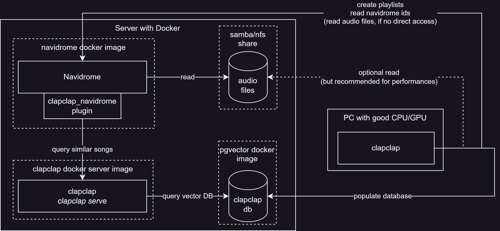

# clapclap

clapclap is a python CLI for managing your CLAP embedding (Contrastive Language-Audio Pretraining).

It can be used as a song recommendation system for Navidrome.

> clapclap is build with the idea of working well with small and large databases

## Recommended setup with Navidrome



## Install

The same python package can be installed in two modes:

- Light: Bare necessary to run the server
- Full: All dependencies, can compute new embeddings (includes: pytorch, transformers, etc...)

For the navidrome extension please refer to the clapclap_navidrome repository: https://github.com/TheRaphael0000/clapclap_navidrome

### Install CLI with PyPi

todo

### Install Server with Docker

todo

### Install from sources

```bash
git clone https://github.com/TheRaphael0000/clapclap
cd clapclap

# install all dependencies (~+1GB, for pytorch & transformers), allows embedding computations
pip install ".[all]"
# or install light version, for server run for example
# pip install .
# or install with dev capabilities
# pip install -e ".[all]" --group dev

# test install
clapclap

# if run locally
vim ~/.config/clapclap/config.ini # see configuration section
```

## Configuration

Every configuration key value can either be set with environement variable when running the script (useful for docker for example). Or in a .ini configuration file.

Default configuration file location is: `~/.config/clapclap/config.ini` But it can be overwritten with the `--config`

config.ini should start with `[settings]`

| Key                       | Description                                                                                    | Default value          | Setup (Server or CLI) |
| ------------------------- | ---------------------------------------------------------------------------------------------- | ---------------------- | --------------------- |
| POSTGRES_USER             | Username for the pgvector DB                                                                   | user                   | Both                  |
| POSTGRES_PASSWORD         | Password for the pgvector DB                                                                   | password               | Both                  |
| POSTGRES_DB               | clapclap database name in pgvector                                                             | clapclap               | Both                  |
| POSTGRES_HOST             | Hostname of the pgvector DB                                                                    | 127.0.0.1:5432         | Both                  |
| DATA_ROOT_DIR             | Path to the audio files, navidrome                                                             | /music/                | CLI                   |
| NAVIDROME_URL             | URL of your Navidrome instance                                                                 | http://127.0.0.1:4533/ | CLI                   |
| NAVIDROME_USER            | Navidrome account                                                                              | user                   | CLI                   |
| NAVIDROME_PASSWORD        | Navidrome password                                                                             | password               | CLI                   |
| NAVIDROME_ROOT_DIR        | Full path of your music directory on your navidrome server, needed to do exact path substition | /music/                | CLI                   |
| NAVIDROME_PLAYLIST_PREFIX | Optional prefix for all clapclap created playlists                                             | _empty_                | CLI                   |

### Example for clapclap CLI

```bash
# ~/.config/clapclap/config.ini
[settings]
POSTGRES_USER=clapclap
POSTGRES_PASSWORD=mydbpass1234
POSTGRES_DB=clapclap
POSTGRES_HOST=192.168.0.2:5432
DATA_ROOT_DIR=/mnt/samba/music/
NAVIDROME_URL=https://navi.example.com
NAVIDROME_USER=navi
NAVIDROME_PASSWORD=mynavipass1234
NAVIDROME_ROOT_DIR=/music/ # slash is important here
NAVIDROME_PLAYLIST_PREFIX=cc
```

## CLI

Commands examples, for the full list use `--help` with any subcommand

```bash
clapclap --help # list subcommands
clapclap update --help # work for any subcommand

# create the database
clapclap db --create

# update the clapclap database with the
clapclap update
# to download songs through navidrome API instead of network mount or local files
# clapclap update --navidrome

# query the database using the text strategy using "breakcore"
# limit it to 100 closest songs and save it to navidrome
clapclap query --save --limit 100 text "breakcore"

# start a clapclap server, not useful locally, must be run on the navidrome server, see
clapclap serve
```

### Example of an update script

```bash
#!/bin/bash
# run a navidrome scan in detached mode
clapclap navidrome scan --detach
# start updating your clapclap database, compute the clap embeddings
clapclap update
# wait for the scan previously started to finish
clapclap navidrome scan --wait
# update the clapclap database with IDs from navidrome, we assume that the new songs are within the 50 newest albums added to navidrome to have a faster matching
clapclap navidrome update --limit 50
```

### Example of a clustering script

```bash
#!/bin/zsh
# remove navidrome playlists starting with 'cc'
clapclap navidrome playlist -r "cc.*" -d
# create 500 playlists using kmeans on navidrome and name them using 1 genre for the smart-naming
clapclap clustering --save --prefix "cc/" --smart-naming-size 1 kmeans -k 500
```